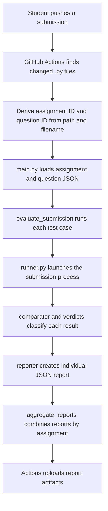

# Evaluator Architecture and Core Functions

This document describes the current implementation. The code is intentionally
small: configuration loading, process execution, comparison, verdict selection,
and report generation are separate so each part can be understood and tested.

## Evaluation flow

## Configuration and data objects

### `evaluator/case.py`

`TestCase` is a dataclass containing a test name, input string, and expected
output string. The evaluator passes `input_data` to the process through stdin.

### `evaluator/config_loader.py`

- `AssignmentConfig` contains assignment name, shared time limit, and optional
  legacy assignment-level test cases.
- `QuestionConfig` contains question ID/name, inherited time limit, and the
  question's test cases.
- `_validate_id` rejects empty IDs and path-like IDs.
- `_load_json_object` reads a JSON object and reports missing files or invalid
  top-level JSON types.
- `_parse_test_cases` validates the required `name`, `input_data`, and
  `expected_output` string fields and creates `TestCase` instances.
- `load_assignment_config` reads `assignments/<id>/assignment.json`. It
  validates the assignment name and positive time limit. `test_cases` is
  optional to support the question-based layout; if present, it must be a
  non-empty list.
- `load_question_config` reads assignment metadata, then
  `assignments/<id>/questions/<question-id>.json`. It returns that question's
  validated cases and the assignment's time limit.

The new format places test cases in question files. The older format, where
test cases live in `assignment.json`, remains usable by invoking the CLI
without `--question`. Question JSON may also contain descriptive metadata such
as topics, prompt, requirements, or bonus text. The current loader ignores
those fields; only the name and test cases affect execution.

## Execution and verdicts

### `evaluator/runner.py`

`run_program(file_path, input_data, timeout)` invokes the current Python
interpreter (`sys.executable`) with the submission path. `subprocess.run`
provides stdin and captures stdout/stderr. On timeout, the function returns a
payload with `timed_out=True`; otherwise it includes the process return code
and captured streams.

The runner does not implement OS-level isolation, memory limits, network
restrictions, or a full process-tree supervisor. It is not a secure sandbox.

### `evaluator/comparator.py`

`compare_output(actual_output, expected_output)` compares strings after calling
`.strip()` on each. This ignores whitespace only at the beginning and end;
internal whitespace remains significant.

### `evaluator/verdicts.py`

`determine_verdict(output, is_correct)` applies this order:

1. `TLE` when the runner marks a timeout.
2. `RE` when the process return code is missing or non-zero.
3. `AC` when the process exited successfully and output matched.
4. `WA` for a successful process with a mismatch.

`IE` is defined in the enum but is not currently assigned by this flow.

### `evaluator/evaluator.py`

`evaluate_submission(file_path, test_cases, timeout)` loops over all test cases.
It invokes the same submission file once per case, compares the output, selects
a verdict, and returns one result record per test. It does not stop after the
first failing case.

## CLI and report generation

### `main.py`

`main()` parses:

- `--assignment` (required): assignment directory ID.
- `--submission` (required): Python file path; relative paths resolve from the
  evaluator repository root.
- `--question` (optional for legacy configs): question ID for question-based
  assignments.
- `--report-output` (optional): report file path; defaults to
  `evaluation_report.json` in the repository root.

With a question ID, the CLI loads the question config. Without one, it uses
legacy assignment-level cases and reports a usage error if none are configured.
It prints the report JSON and writes the same JSON to the report file.

### `evaluator/reporter.py`

- `generate_report(execution_results)` produces per-test detail, counts,
  pass percentage, and test-case results. A score is `passed / total_tests *
  100`, rounded to two decimal places.
- `generate_assignment_report(question_reports)` produces a summary for the
  report inputs supplied to it. Its overall score is weighted by the number of
  test cases, and config-error reports are counted as question errors. It does
  not add unsubmitted questions to the denominator.

### `evaluator/aggregate_reports.py`

This command-line module reads report JSON files passed with `--reports`, calls
`generate_assignment_report`, and writes the result to `--output`. The workflow
calls it once for each assignment present in the push.

## GitHub Actions integration

The workflow lives in the student repository at
`.github/workflows/evaluate-submission.yml`:

1. It triggers on pushes affecting Python files under
   `assignments/**/submissions/`; the evaluation loop accepts files directly
   inside each `submissions/` directory.
2. It compares the push's before/after Git revisions and selects added,
   copied, modified, renamed, or type-changed files.
3. For a submission named `q1_calculator.py`, it derives assignment ID from
   the assignment directory and question ID `q1` from the portion before the
   first underscore.
4. It checks out the evaluator repository, invokes `main.py`, and writes an
   individual report for each changed file.
5. If evaluation fails to load/run, it writes an error report and continues
   processing other files. After processing, it aggregates reports by
   assignment; if any evaluation failed, the workflow step exits unsuccessfully
   after aggregation.
6. A following `always()` upload step attempts to upload JSON reports,
   including reports on a failed evaluation step.

The workflow currently selects the evaluator repository's default branch,
not a pinned tag or commit. The assignment ID and question ID must match the
directory and question JSON names in that checked-out evaluator version.

## Tests

Pytest coverage is under `assignments/01-python-basics/tests/`:

- `test_config_loader.py`: legacy and question config loading, invalid IDs, and
  missing assignment/question files.
- `test_evaluator.py`: evaluates the sample submission against the q1 cases.
- `test_cli.py`: invokes the question CLI and checks the written report.
- `test_reporter.py`: verifies per-question scores and assignment aggregation.
- `test_verdicts.py`: covers verdict classification.
- `test_q1.py`: sample calculator behavior.

Run from the evaluator repository root with `python -m pytest`.

